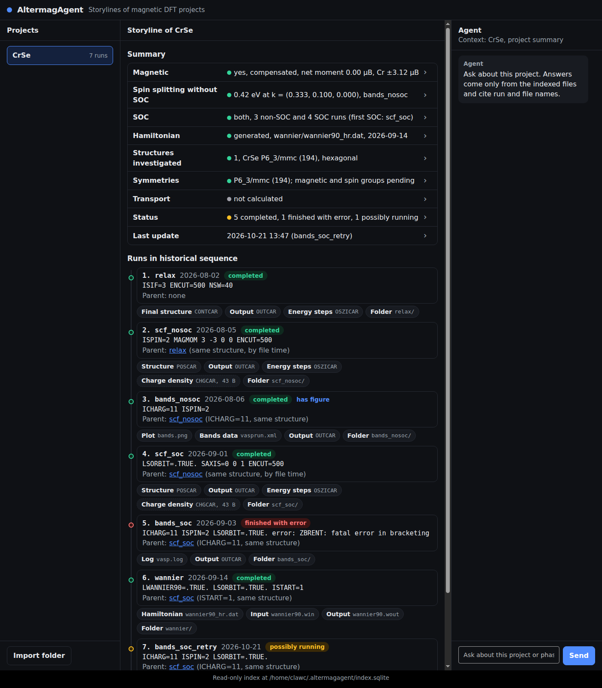
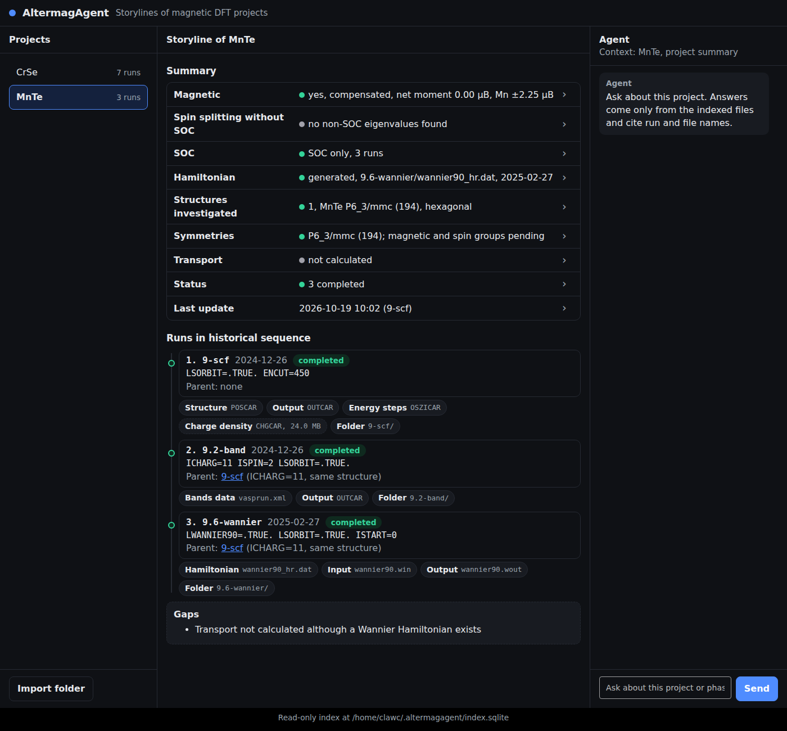

# AltermagAgent

AltermagAgent reads a tree of VASP calculation folders and never changes them.
It rebuilds the project storyline: the runs in order, how each run came from the one before, and eight summary points with the files behind each one.
It also shows the branches of the project with suggestions for the next calculations.
It shows the storyline in a three-panel browser interface with a chat that answers only from what it found in your folders.

## Screenshots

- `screenshot_v1.png`: the synthetic CrSe demo project in the interface.
- `screenshot_v2_MnTe_real.png`: a real MnTe altermagnet project.





## Reproduce the demo in five commands

Run these after the install below, with the virtual environment active.

```bash
python demo/make_demo.py
altermag import demo/CrSe_demo --name CrSe
altermag summary CrSe
altermag bands CrSe bands_nosoc
altermag gui
```

Then open http://localhost:8080/?project=CrSe in your browser.

## Install

You need Python 3.12 or newer and git.
The steps below use `python3.14`; use `python3.12` or `python3.13` if that is what you have.
A first install downloads about 90 packages and takes about three minutes; a repeat install takes under a minute.

```bash
git clone https://github.com/joshbarron-36/altermagagent.git
cd altermagagent
python3.14 -m venv .venv
```

Activate the virtual environment, using the line for your system.

```bash
source .venv/bin/activate          # Linux and Mac
```

```
.venv\Scripts\activate             # Windows, Command Prompt or PowerShell
```

Then install the packages and the `altermag` command.

```bash
pip install -r requirements.txt
pip install -e .
```

On Windows, use `py -3.12 -m venv .venv` if `python3.14` is not found.

## The demo project

`python demo/make_demo.py` writes `demo/CrSe_demo`, a synthetic CrSe project with seven runs, so you need no VASP to try the tool.
It contains a relaxation, SOC and non-SOC scf and band runs, a failed run, a run that may still be running and a Wannier run.

```bash
python demo/make_demo.py
altermag import demo/CrSe_demo --name CrSe
altermag summary CrSe
```

## Commands

```bash
altermag import <folder> --name <project>    # read-only scan of a folder tree into the index
altermag summary <project>                   # eight summary points, branches, gaps, runs in order, procedure checks
altermag graph <project>                     # branches (structure, magnetic realization, SOC) and their runs as text
altermag suggest <project> <branch>          # suggestions for the next DFT calculations of one branch
altermag literature <project>                # published papers found by search, not evidence from the files
altermag bands <project> <run> [--emin -3] [--emax 3] [--style paper]
altermag structure <project> <run> [--supercell 1 1 1]
altermag compare-wannier <project> [path/to/wannier90_hr.dat] [--run-name <run>]
altermag gui [--port 8080]                   # start the browser interface
```

### import

`altermag import` walks the folder tree and stores one entry per VASP run in the index.
Importing again under the same name replaces the project.
Large outputs such as CHGCAR, WAVECAR and PROCAR are never opened; only their size and date are kept.

### summary

`altermag summary` prints the eight points: structures, magnetism, symmetries, SOC, Hamiltonian, transport, status and last update.
The Symmetries point gives the magnetic space group once per magnetic realization, with its magnetic point group; the crystal space group is in the Structures point.
The Magnetic point lists every magnetic realization found, for example "collinear (3 runs); coplanar (10 runs)", with net and site moments.
The spin splitting scan is no longer a summary point; it stays in the band figure output of `altermag bands`.
It then lists the gaps, for example a Wannier Hamiltonian without a transport step.
Each run has a phase (relax, scf, band, wannier, symmetrisation, projection, transport or other) and procedure checks.
The checks come from a written DFT procedure in `docs/detection_rules_from_procedure.md`, for example EDIFF and the number of job slots.

### graph and magnetic realizations

`altermag graph` groups the runs into branches and prints each branch with its runs in historical order and their parent links.
A branch is one structure, one magnetic realization and one SOC setting.
The structure match uses pymatgen StructureMatcher without volume rescaling and with a 1 percent lattice tolerance.
The magnetic realization comes from INCAR MAGMOM, or from the converged OUTCAR moments when MAGMOM is missing.
It is classified as collinear, coplanar, non-coplanar or non-magnetic, and two runs share it when their moment patterns agree up to one global rotation within 0.1 μB.
A branch is named after its first folder plus noSOC or SOC, such as `coplanar-SOC`, when that is unambiguous, otherwise `realization-1-SOC`.

### suggest

`altermag suggest <project> <branch>` prints the suggestions for the next DFT calculations of one branch.
It follows the physicist's loop in six steps, each marked done, partial, missing or not applicable with its evidence file:
(a) structure and moments, (b) symmetries, (c) converged SCF, (d) band structure and projections, (e) Wannierisation, (f) transport.
Step (b) runs "define MSG": spglib computes the magnetic space group of the branch's first converged run.
It uses the converged OUTCAR moments, or INCAR MAGMOM when the run has no OUTCAR, and tags the label "parsed, pending validation".
The magnetic space group counts as done when a findsym.log lies in the folder of the branch or above it.
Its label is then shown "from findsym.log", with the computed label next to it and "agree" or "differ".
The tool always writes the FINDSYM input (structure and moment vectors) to `~/.altermagagent/msg/<project>/<branch>/findsym.in`.
In the interface the same action is the "define MSG" button under the suggestions of the selected branch.
The suggestions end with the section "From the literature, not from these files"; without `VALENCY_TOKEN` it says "literature unavailable".
The first missing step becomes the recommended next calculation, written as one sentence with the INCAR tags to change.
The tool never states that a material is an altermagnet.

### bands

`altermag bands` reads `vasprun.xml` and `KPOINTS` of a band run and draws the bands relative to the Fermi level.
A labelled line-mode `KPOINTS` gives the high-symmetry labels; otherwise the x axis is the k-point index.
Spin-polarised runs without SOC show spin up in blue and spin down in red, with the largest splitting and its k-point.
SOC runs are drawn in one colour.
The `paper` style is white, serif and 300 dpi; the `screen` style is a larger figure for slides.

### structure

`altermag structure` reads POSCAR (or CONTCAR) and the MAGMOM line of INCAR and draws the atoms with the moments as arrows.
The arrows are the starting moments from INCAR, not the converged moments from OUTCAR.
The interactive HTML view loads 3Dmol.js from the internet; the PNG and SVG work offline.

### compare-wannier

`altermag compare-wannier` (alias `wannier-compare`) overlays a Wannier Hamiltonian on the VASP bands of its ancestor band run.
Without required input equality (POSCAR, INCAR, CHGCAR, CHG) it refuses, unless `--structure-only` asks for a preliminary overlay.
Errors are computed only with `--band-start N`, where Wannier band 1 is VASP band N, within -1 to +1 eV by default (`--window`).
They are MAE, RMSE, the 95th percentile, the maximum and the count of samples above 20 meV.
`--band-start auto` picks the offset by smallest error, and the figure, the JSON and step (e) then say "not verified".
Without seedname_wsvec.dat or a use_ws_distance=false declaration, the direct-HR fallback is named in the figure and the JSON.
Options: `--reference-run` (alias `--reference`), `--emin`, `--emax`, `--fermi-eV`, `--spin up|down`, `--out-dir` and `--no-ws-distance`.
Step (e) runs the comparison in preliminary mode with the automatic offset, so its line starts with "preliminary:".
The module was written by Diana Golovanova.

For Hamiltonian overlays, see the [Wannier comparison README](docs/wannier_comparison/README.md).
It documents ancestor discovery, matching inputs, preliminary comparisons and the generated figures.

### gui

`altermag gui` starts the interface on http://localhost:8080.
The left panel lists projects and has an Import folder button.
The middle panel shows the eight points, then a graph of the branches drawn like a git history, then the selected branch.
The graph has one lane per branch, one node per run in time order coloured by phase, and lines for parent links.
Click a node or a lane to select its branch: its header with the 3D structure view, its run cards in order and its suggestions.
Click a summary point to see its evidence files, and click a run card to see its files, parameters, moments and procedure checks.
Band runs have a Plot pill with energy inputs and a Redraw button, and runs with a structure file have a Structure pill.
The right panel is the chat.

## Open a project directly

Add `?project=NAME` to the address, for example http://localhost:8080/?project=MnTe.
Without it, the interface opens the first project in the index.

## The chat

The chat answers only from the indexed summary and runs, and names the run and file behind each fact.
It can draw a band figure when you ask for one.
It picks its model in this order: an Anthropic key, then a local Ollama server, then a fixed notice.

### With an Anthropic API key

```bash
export ANTHROPIC_API_KEY=sk-ant-...     # Linux and Mac
```

```
set ANTHROPIC_API_KEY=sk-ant-...        # Windows Command Prompt
$env:ANTHROPIC_API_KEY="sk-ant-..."     # Windows PowerShell
```

Set the key in the same terminal before `altermag gui`.
The key is read from the environment only and is never stored in the code.

### With Ollama, no key needed

1. Install Ollama from https://ollama.com/download.
2. Download a model once: `ollama pull llama3.1:8b`.
3. Keep `ollama serve` running; the Ollama desktop app does this for you.
4. Start `altermag gui` and ask in the chat panel.

The chat finds the server at `OLLAMA_HOST` (default `http://localhost:11434`).
To use another model, pull it and set `ALTERMAG_OLLAMA_MODEL`, for example `export ALTERMAG_OLLAMA_MODEL=qwen2.5:7b`.
An 8 billion parameter model needs about 6 GB of free memory.
Drawing figures from the chat works with llama3.1 and qwen models; other models still answer and point you to the Redraw button.

## Literature, kept apart from the files

A separate section, "From the literature, not from these files", follows the suggestions of the selected branch in the interface.
It also follows the branches in `altermag summary` and the suggestions in `altermag suggest`; `altermag literature <project>` prints only that section.
It lists published papers found by a search of the Valency literature service (https://labs.valency.io/mcp), not evidence read from your folder.
The suggestions never change because of these papers.
For the project formula it runs up to two searches, for example "MnTe altermagnet spin splitting" and "MnTe magnetic order P6_3/mmc".
Each search shows up to three papers with title, first author, year and link.
Results are cached per search for 24 hours in `~/.altermagagent/literature_cache.json`.
The chat can call the same search as a tool; its answers are labelled "from the literature" and cite title and year.

The search needs a Valency access token in the environment variable `VALENCY_TOKEN`.
Without it, or when the service fails or refuses the token, the section prints "literature unavailable" with the reason, and everything else works as before.

How to get a token:
1. Valency uses OAuth with a browser login; there is no key to copy from a web page.
2. Register an OAuth client through the service's registration endpoint, listed at https://labs.valency.io/.well-known/oauth-authorization-server.
3. Open the authorization URL in a browser with PKCE, log in, and let it redirect to a small local callback server.
4. Exchange the returned code at the token endpoint for an access token and a refresh token.
5. Export the access token as `VALENCY_TOKEN`, for example from a private file such as `~/.altermagagent/env`, then `source` that file.
6. When the token expires, exchange the refresh token for a new one at the same token endpoint.

On Josh's laptop a small login script outside this repository does these steps and writes `~/.altermagagent/env`; run its refresh option when the token expires.

## Notebook walkthrough with marimo

`notebooks/altermagagent_walkthrough.py` is a marimo notebook that shows the whole demo and analysis in one file.
It shows the summary points, the per-branch suggestions, the runs in order, the band and structure figures and the benchmark.
Two sliders set the energy window of the band figure, and a dropdown picks the project; no API key is needed.
If the index is empty, the notebook imports `demo/CrSe_demo` first.

```bash
marimo edit notebooks/altermagagent_walkthrough.py   # editable view with the code
marimo run notebooks/altermagagent_walkthrough.py    # app view without the code
```

## Where the index and figures live

Everything the tool writes goes to `~/.altermagagent`:

- `index.sqlite`: the index of all imported projects.
- `figures/<project>/`: band and structure figures as PNG, SVG, HTML and JSON.
- `agent_calls.log`: one line per chat call with provider, model and token counts.

Set `ALTERMAG_HOME` to use another folder, for example `export ALTERMAG_HOME=/tmp/altermag_test`.

## Your data folders are never written

The scan, the figures and the chat only read your VASP folders.
Nothing is ever written inside a scanned folder, and the import refuses a folder that contains the index.
You can point the tool at a shared or backed-up project tree without risk to it.

## Known limits

- Measured accuracy on 20 synthetic CrSe trees: phase 100 %, status 100 %, parent 98.5 %; files copied with `cp -p` can still reorder runs, see `docs/accuracy.md`.
- Magnetic space groups and spin groups are not computed yet; the summary says "pending".
- Reading folders on a cluster over SSH is not available yet; copy or mount the folders locally.
- Small Ollama models (3 billion parameters) give weak answers and sometimes draw figures nobody asked for.
- Structure arrows show the INCAR starting moments, not the OUTCAR moments.
- The 3D structure view needs an internet connection.

## Software and references

AltermagAgent builds on the work of others; please cite them when you use its results.

Symmetry analysis:

- spglib (crystal and magnetic space groups): A. Togo, K. Shinohara, I. Tanaka, Sci. Technol. Adv. Mater.: Methods 4, 2384822 (2024), https://doi.org/10.1080/27660400.2024.2384822
- spglib magnetic space group search: K. Shinohara, A. Togo, I. Tanaka, Acta Cryst. A 79, 390 (2023), https://doi.org/10.1107/S2053273323005016
- spinspg (spin groups of collinear non-SOC runs): K. Shinohara et al., Acta Cryst. A 80, 94 (2024), https://doi.org/10.1107/S2053273323009257
- Symmetr: J. Železný, "Symmetr: a Python package for determining symmetry properties of crystals", arXiv:2602.21034 (2026), code at bitbucket.org/zeleznyj/linear-response-symmetry

How the CrSe and MnTe data were computed (Diana Golovanova):

The DFT calculations were performed with the Vienna ab initio simulation package (VASP) with projector augmented wave (PAW) potentials [1, 2].
Exchange and correlation were treated in the generalized gradient approximation (GGA) with the Perdew-Burke-Ernzerhof (PBE) functional [3].
The tight-binding Hamiltonians were extracted with maximally localized Wannier functions through the VASP2WANNIER90 interface [4, 5].

1. G. Kresse, J. Furthmüller, Phys. Rev. B 54, 11169 (1996), https://doi.org/10.1103/PhysRevB.54.11169
2. G. Kresse, D. Joubert, Phys. Rev. B 59, 1758 (1999), https://doi.org/10.1103/PhysRevB.59.1758
3. J. P. Perdew, K. Burke, M. Ernzerhof, Phys. Rev. Lett. 77, 3865 (1996), https://doi.org/10.1103/PhysRevLett.77.3865
4. N. Marzari, D. Vanderbilt, Phys. Rev. B 56, 12847 (1997), https://doi.org/10.1103/PhysRevB.56.12847
5. G. Pizzi et al., J. Phys.: Condens. Matter 32, 165902 (2020), https://doi.org/10.1088/1361-648X/ab51ff

Wannier Hamiltonian symmetrisation (outputs read by the tool):

- wannhr_symm_Mag: A tool for symmetrization of magnetic WannierTB, https://github.com/quanshengwu/wannier_tools/tree/master/utility/wannhr_symm_Mag, Changming Yue.
- wannhr_symm: A tool for symmetrization of non-magnetic WannierTB, https://github.com/quanshengwu/wannier_tools/tree/master/utility/wannhr_symm/, Changming Yue.

Codes whose outputs are read, and libraries used:

- VASP and Wannier90: references [1] to [5] above.
- pymatgen (structures and matching): S. P. Ong et al., Comput. Mater. Sci. 68, 314 (2013), https://doi.org/10.1016/j.commatsci.2012.10.028
- 3Dmol.js (3D structure view): N. Rego, D. Koes, Bioinformatics 31, 1322 (2015), https://doi.org/10.1093/bioinformatics/btu829
- Literature search: the Valency MCP platform, https://labs.valency.io
- Interface and notebook: NiceGUI (https://nicegui.io), marimo (https://marimo.io), matplotlib and plotly.
- Wannier band comparison module: Diana Golovanova, see `docs/wannier_comparison`.

## License

See `LICENSE`.
