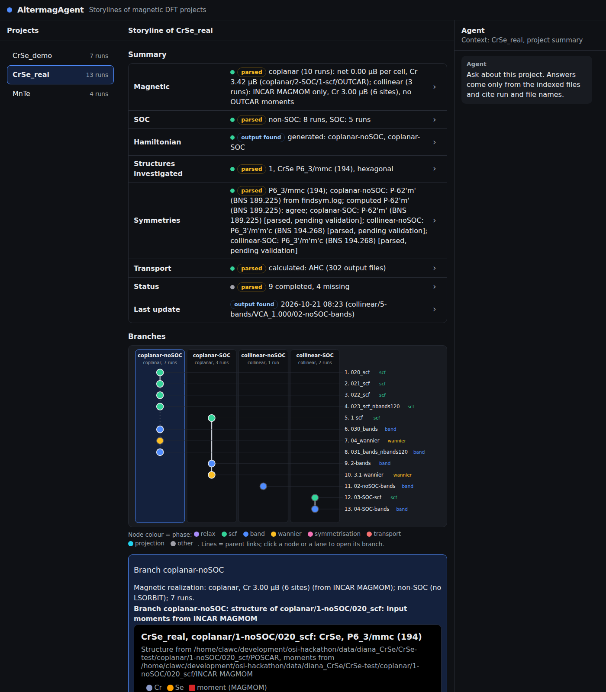

# AltermagAgent: which claims do these calculation folders support?

**Team:** Diana Golovanova (Weizmann Institute of Science), Josh Barron, Poulami Sadhukhan (CSIR National Chemical Laboratory).
**Repository:** https://github.com/joshbarron-36/altermagagent (public at submission).

## The problem

Computational materials projects live in scattered VASP folders whose history is not written down anywhere.
Months later, nobody can say which run supports which conclusion, or what to run next.
Workflow tools record provenance only for work done inside them, so older folders stay opaque.

## What the tool does

- Reads a folder tree read-only and never opens CHGCAR, WAVECAR or PROCAR.
- Rebuilds the storyline: the phase of each run, the order, and parent links with a stated reason, a list of candidates, or "unknown".
- Groups runs into branches (one structure, one magnetic realization, one SOC setting) and draws them as a graph like a git history.
- Gives eight summary points, each with its evidence files and a tag: output found, parsed, validated or insufficient evidence.
- Writes per-branch suggestions in the physicist's six steps, from structure to transport, each done, partial or missing, then the next calculation.
- Computes the magnetic space group with spglib and compares it with the user's findsym.log, or writes findsym.in to check it.
- Draws band and structure figures; a chat answers only from the indexed files and cites them.

## Main example: CrSe

Diana's CrSe project has 13 runs and 1127 files; the scan took 3.2 seconds.
The Magnetic point lists two realizations: coplanar in ten runs, net 0.00 μB per cell in OUTCAR, and collinear in three runs, from INCAR MAGMOM only.
The graph shows four branches: coplanar non-SOC (7 runs), coplanar SOC (3), collinear non-SOC (1) and collinear SOC (2).

- **Symmetry:** on coplanar non-SOC, spglib on the 022_scf moments gives P-62'm' (BNS 189.225), the same label as Diana's findsym.log.
- **Convergence:** OSZICAR shows that 020_scf and 021_scf stopped at 200 and 160 steps above EDIFF; step (c) cites 023_scf_nbands120, which converged.
- **Transport:** anomalous Hall output was found on the coplanar SOC branch (3.1-wannier/AHC/ahc.dat), parsed, not validated.
- **Next:** findsym on coplanar SOC, the Hall conductivity on coplanar non-SOC, a new SCF on collinear non-SOC.

The three other magnetic labels are computed and tagged pending validation until Diana runs findsym on them.



*Figure: the real CrSe project in the interface: eight summary points and the graph of 13 runs in four branches.*

## Second example: MnTe

Diana's MnTe project has four runs and 175 files, scanned in 0.86 seconds, all in one SOC branch.
The tool computed the magnetic space group Cm'c'm (BNS 63.462) from the 9-scf OUTCAR moments, and her own findsym.log in 9-scf gives the same label.

## Measured accuracy

A generator writes 20 synthetic CrSe trees with a known truth for each run: its phase, its status and its parent.
The trees vary folder names, strain, Hubbard U, failed runs and deleted restart files.
On 137 runs the importer got phase 137 (100 %), status 137 (100 %) and parent 135 (98.5 %); the method is in docs/accuracy.md.

## Literature, kept apart

Under each branch's suggestions, a section headed "From the literature, not from these files" lists published papers from a Valency search.
The papers never change the suggestions.

## What it refuses to claim

The tool never states that a material is an altermagnet on the basis of the files.

## Reproduce in five commands

After `git clone` of the repository, on Linux or Mac:

```bash
python3.14 -m venv .venv && source .venv/bin/activate
pip install -r requirements.txt && pip install -e .
python demo/make_demo.py
altermag import demo/CrSe_demo --name CrSe
altermag summary CrSe
```

Then `altermag gui` opens the interface at http://localhost:8080/?project=CrSe.
The demo tree is synthetic CrSe, so no VASP installation is needed.

## What is next

After the hackathon we plan spin group analysis, SSH access to computing clusters, and planning of new calculations.
The tool is free and open under the Apache 2.0 license.
